# Stereotypes on screen

How film and TV cast, write about and label women and social groups, measured across IMDb's full title catalogue,
TMDb's TV and film records and three million plot summaries (IMDb, TMDb and Wikipedia), 1920–2026.

This expands [Stefano Li Pira](https://github.com/stefanolipira)'s 2022 initiative to measure stereotypes in TV
series, which he and Alexandru Pascu first explored with a BERT classifier (kept in [`2022-bert/`](2022-bert/), tag
`v2022`). The follow-up replaces the classifier with measures that can be checked against the data, then rebuilds the
classifier properly and adds the word-embedding method from the project's [original reading list](#references).

*Content note: the word lists and result tables contain stereotypes about groups of people, collected in order to
measure them. Slurs and insulting labels are counted but left out of every published table.*

## At a glance

| Study | Main finding |
| --- | --- |
| [1. Who plays whom](#1-who-plays-whom) | Detectives, judges and lawyers went from almost never women to 20–30% women; nurses, nannies and receptionists are still 83–90% women. |
| [2. Who writes the film or episode](#2-who-writes-the-film-or-episode) | Films written by women cast 11 points more women than comparable films written by men (8 points even for films by the same director) and far more often give a woman the first-listed role; within a TV series the gap is about 3 points. |
| [3. What characters do in plot summaries](#3-what-characters-do-in-plot-summaries) | Women went from 28% to 46% of the people summaries talk about, but are still described by their looks 1.5 times as often as their share. |
| [4. Do audiences care?](#4-do-audiences-care) | Within a TV series, the word-list and casting measures go with less than 0.04 points of an episode's IMDb rating, though noisy measures understate such differences. Films whose summary the study 9 classifier reads as a stereotyped portrayal rate about 0.3 points lower than the same director's other films, and films with more women on screen slightly lower (0.12 points for an all-female against an all-male cast). |
| [5. Groups, stereotype words and slurs](#5-groups-stereotype-words-and-slurs) | Slurs in character names fell ninefold, but pejorative stereotype words still cluster around group mentions as much as in the 1950s. |
| [6. The language of plot summaries](#6-the-language-of-plot-summaries) | Word embeddings trained on the summaries track the census and on-screen casting; gender-coded wording has halved since the 1950s, while terrorism words moved back towards Islam after 2001. |
| [7. A classifier, done properly](#7-a-classifier-done-properly) | Without the 2022 length shortcut it reaches AUC 0.71–0.76, not 0.95 — and what it detects is stories *about* prejudice, not stereotyped portrayals. |
| [8. Checking the measures](#8-checking-the-measures) | A careful reading of 3,000 summaries confirms the measures: stereotyped portrayals fell from 25% of pre-1970 film summaries to 9% today, and from 16% to 5% on TV. |
| [9. A classifier trained on careful labels](#9-a-classifier-trained-on-careful-labels) | Trained on those labels, EmbeddingGemma-2 recognises stereotyped portrayals (AUC 0.86–0.90); on 37,049 fresh summaries, film portrayals fall from 22% in the 1930s to 8% now, and Westerns and romances lead. |
| [10. Behind the camera, leads and ages](#10-behind-the-camera-leads-and-ages) | Women went from 3% (before 1950) to 16% of film directors and 5% to 23% of TV directors; they still hold only 38% of first-listed film roles, and the first-listed man is about 6 years older than the first-listed woman (9 before 1950). |
| [11. Six more groups](#11-six-more-groups-immigrants-disability-mental-illness-age-class-and-homelessness) | Films stereotype immigrants, disabled and mentally ill, older, poor and homeless people in a steady 5–6% of summaries from the 1930s to the 2010s (4.5% in the 2020s), unlike gender and the groups of study 5; mental illness appears three times as often as then, and horror stereotypes these groups most. |
| [12. Money, critics and awards](#12-money-critics-and-awards) | Films with stereotyped portrayals take less at the box office (23% less than the same director's other films at the same budget) and get fewer Oscar nominations, and critics and audiences mark them down alike. Casts with more women return more per dollar (a loose estimate); audiences rate them lower, critics barely. Series that open with stereotyped portrayals are renewed a little less often (a loose estimate). |
| [13. Who makes stereotyped films, and where](#13-who-makes-stereotyped-films-and-where) | Films and series made by women contain 15–34% fewer group stereotypes in the main comparisons and, once their casts are compared, no more gender stereotypes. Big-budget films stereotype a little less (18% over $100 million against 21–22%, at the same summary length), and countries of origin (16–26%) differ far more than TV networks (10–13%). |

## 1. Who plays whom

Jobs in credited character names ("Nurse", "Detective Morales", "Dr. Patel"), and whether an actor or an actress
played them. English-language film and TV: 2.5 million named fictional roles (of 7 million in all languages).

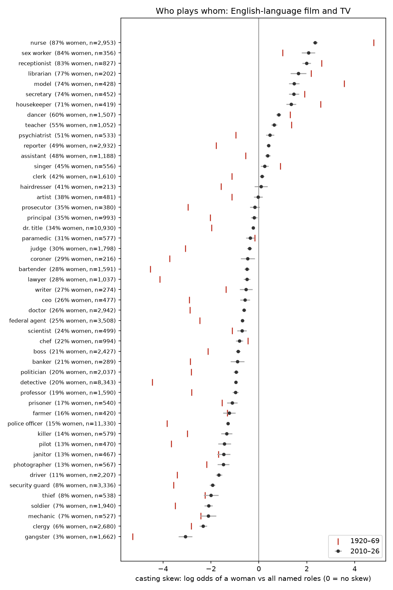

- In 2010–26 women play 90% of nannies, 87% of nurses, 83% of receptionists and 74% of secretaries, but 26% of doctors,
  20% of detectives, 15% of police officers, 7% of soldiers and 3% of gangsters, against 39% of all named roles.
- The biggest changes are in professional and authority jobs: before 1970 women played 0–2% of detectives, judges,
  lawyers, doctors and professors; now they play 19–30%. Reporters went from 6% to 49%, bartenders from 0% to 28%.
- Jobs coded female barely moved: nurses are 87% women today (98% before 1970). Change came from women entering male
  roles on screen, not men entering female ones.

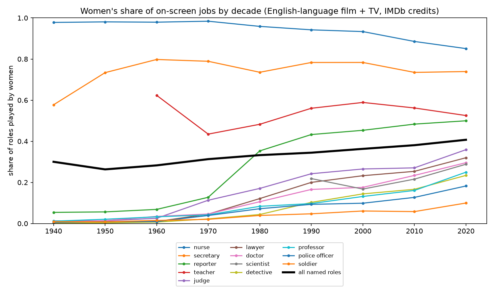

Tables: [`results/occupations/`](results/occupations/).

## 2. Who writes the film or episode

TMDb gives the gender of every credited writer and of at least two guest stars (and of the director for most) for
118,128 episodes of 8,156 scripted series.
Guest stars are cast per episode, which is where an episode's writers have most say.

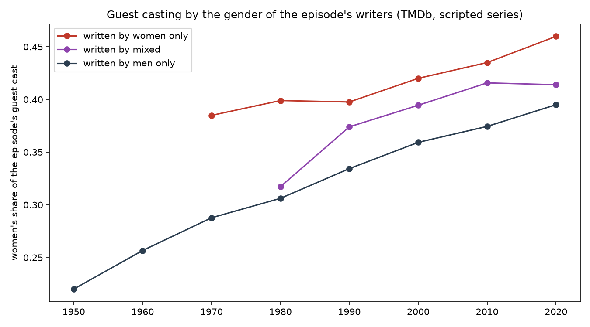

- Comparing episodes of the same series, those written only by women cast 2.9 percentage points more women among
  guest stars than those written only by men (95% interval 2.5–3.3); mixed teams 1.1 points more. The gap holds for
  English-language series (3.1) and for episodes aired since 2010 (2.6).
- Episodes directed by a woman have 0.6 points more women among guest stars, on top of the writers.
- Between shows the gap is larger: episodes of series created only by women average 43% women among guest stars,
  those of series created only by men 35%, though such shows differ in many other ways too.
- Episodes written only by women are no more likely to give guests counter-stereotypical jobs (a woman detective, a
  male nurse): +0.6 points, 95% interval −0.2 to 1.5. Mixed teams are slightly more likely (+1.7 points, 0.5 to 2.9).

IMDb lists the writers and directors of every film and episode too, without gender; gender then comes from performer
credits or, for everyone else, from the first name (see [How it was measured](#how-it-was-measured)). That extends the
study to 266,053 films and checks it on 2.4 million TV episodes.

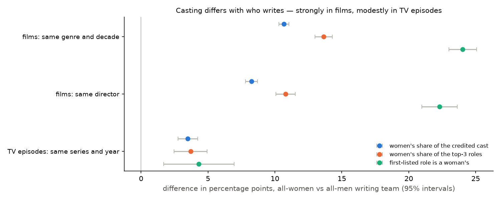

- Films written by women only cast 10.7 percentage points more women than films of the same genre and decade written
  by men only, and 8.2 points more than films by the **same director** with an all-male writing team. Their top three
  roles are 11–14 points more often women's, and the first-listed role is a woman's 22–24 points more often.
- Films by a woman director have 3 points more women in the cast and a woman in the first-listed role 9 points more
  often.
- In TV episodes the IMDb version finds 3.5 points within the same series, consistent with the TMDb result above (2.9) from a
  different source, a different way of knowing gender and a different outcome (the episode's whole listed cast,
  regulars included, rather than guest stars). Film writers shape the whole story and cast; an episode's
  writers work inside a series' fixed cast, which fits the smaller effect.
- These are comparisons, not experiments: women writers may be hired for women-centred projects, which comparing
  films by the same director narrows but cannot rule out.

Tables: [`results/writers/`](results/writers/), [`results/behind_camera/writer_models.csv`](results/behind_camera/writer_models.csv).

## 3. What characters do in plot summaries

Three million English summaries (IMDb, TMDb and Wikipedia) parsed into who-does-what. A character's gender comes from pronouns,
gendered words, or the title's own cast list. Ratios compare women's share of one kind of mention with their share of
all gendered mentions, descriptions included.

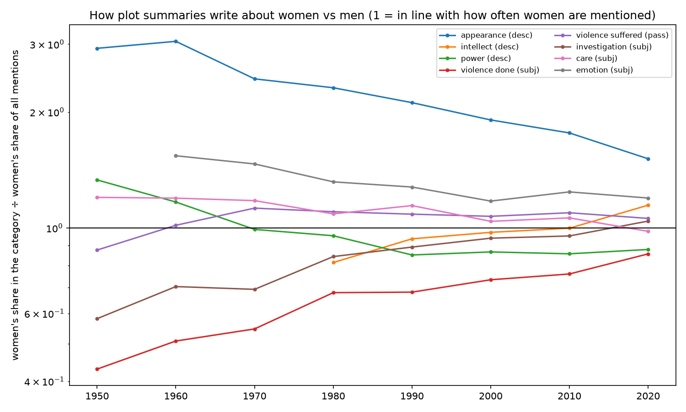

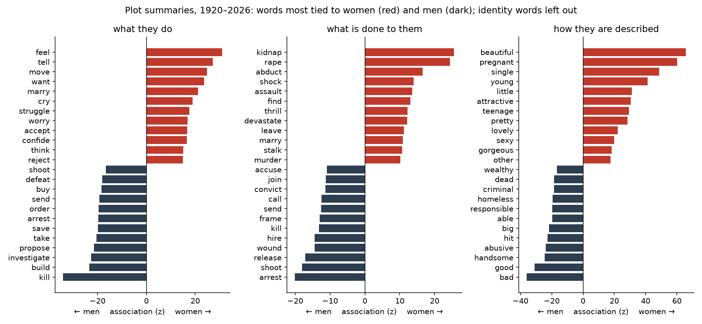

- Women's share of the people summaries talk about rose from 28–29% (1950s–60s) to 46% (2020s), and they are now the
  subject of the action as often as their share would predict.
- Appearance is the most persistent gap: women are described by their looks ("beautiful", "pretty", "attractive",
  "sexy") 3 times as often as their share in the 1950s and still 1.5 times today.
- Investigating or discovering, rescuing and committing violence started far below women's share (0.4–0.6) and are
  now close to it (0.8–1.0); romance-driven verbs fell from 1.4 to parity; emotional verbs ("cry", "worry",
  "panic") fell from about 1.5 in the 1960s–70s to 1.2, still above parity.
- What happens to characters differs sharply: women are kidnapped, raped, abducted, assaulted and stalked; men are
  arrested, shot, wounded, convicted and jailed.

Tables: [`results/agency/`](results/agency/).

## 4. Do audiences care?

The 2022 project asked this of TV episodes with its classifier; it is asked here of episodes and of films. Measures
taken from plot summaries are compared at the same summary length and source, because well-known titles get longer,
more detailed summaries, in which any word is more likely to turn up.

**TV episodes.** Each measure compared across episodes of the same series, with air-year effects, for 887,000 rated
IMDb episodes.

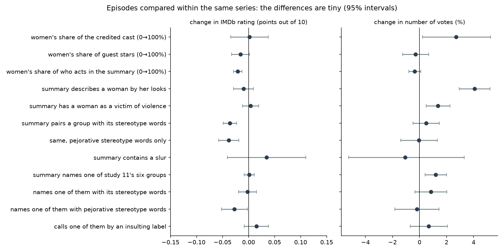

- Ratings barely differ: no estimate exceeds 0.04 points out of 10, and the 95% intervals stay within about ±0.06
  (the rare slurs excepted). The largest is for summaries that pair a group with pejorative stereotype words, 0.04
  points below other episodes of the same series; casting more women, or writing women as the ones who act, goes with
  0.02 points at most.
- Some get more attention: episodes whose summary describes a woman by her looks get 4% more votes, those with a woman
  as a victim 1% more. Without the length control, group stereotypes also seemed to draw 3% more votes; that came
  from popular episodes having longer summaries.
- These episode measures are word lists and casting shares; the study 9 classifier was not run on episodes. The word
  lists hold up as trends but are noisy title by title (right 22–67% of the time, study 8), which pulls these
  estimates toward zero: small differences here do not show that audiences do not care.

**Films.** A film has no other episodes of the same show, so each measure is compared three ways across 210,000 rated
feature films with at least 20 IMDb votes (1950–2026; documentaries and reality formats left out): among a director's own films, with release year and genres held fixed; among the films of
one franchise (TMDb collections); and among films of the same genre combination, decade and original language.

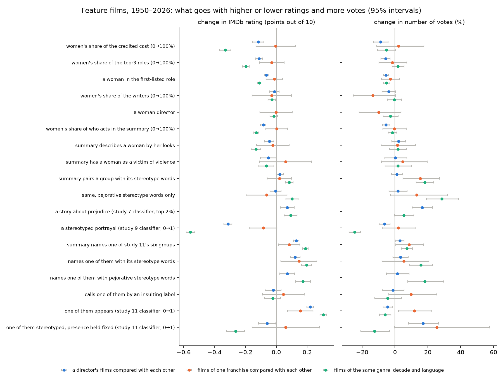

- Films with more women on screen are rated a little lower, also among a director's own films: an all-female
  credited cast rates 0.12 points below an all-male one and gets 9% fewer votes, and a woman in the first-listed role
  0.06 points lower with 6% fewer votes. Franchises offer too few comparisons to confirm or rule this out. IMDb does
  not say who rated, so this cannot separate how the films differ from who votes on them.
- Who wrote or directed the film barely goes with its rating: 0.03 points at most for an all-women writing team,
  nothing measurable for a woman director.
- Films whose summary study 9's classifier reads as a stereotyped portrayal rate lower. Scored on all 188,049 films
  with a summary of at least 15 words, a film the classifier is sure about rates 0.31 points below the same director's
  other films, with genres held fixed (0.56 below similar films; 0.08 within a franchise, too few films to be sure) and draws 6% fewer
  votes. Stories about prejudice (study 7's classifier, top 2%) rate slightly higher (0.07 points) and draw 17% more votes.
- Films that feature one of study 11's six groups (immigrants, disability, mental illness, old age, poverty,
  homelessness) rate higher, among a director's own films too: 0.13 points when the summary names the group, 0.22
  when study 11's classifier reads one as present. Portraying them through a stereotype goes the other way: with
  their presence held fixed, a stereotyped portrayal goes with 0.26 points less across similar films and 0.06 less
  among a director's own films. Stereotype words next to a mention add nothing beyond naming the group, and insulting
  labels make no clear difference. Within a TV series, none of the word-list measures (naming, stereotype words,
  pejorative words, insulting labels) goes with more than 0.03 points; the classifiers were not run on episodes.
- Group stereotype words show no consistent link with ratings among a director's own films. Across similar films
  they rate 0.08–0.10 points higher and draw 18–29% more votes, a gap that looked like 70–100% before summary length
  was held fixed. Slurs are too rare
  in film summaries to tell.

Tables: [`results/ratings/models.csv`](results/ratings/models.csv) (episodes),
[`results/ratings/film_models.csv`](results/ratings/film_models.csv) (films).

## 5. Groups, stereotype words and slurs

Thirty groups (nationalities, ethnic groups, religions, sexual orientation and gender identity), each with a list of
stereotype words from published stereotype datasets and curated lists, and slurs from Wikipedia and HurtLex. The
pejorative index keeps only words rated offensive. The measures pass a check against viewers' own tags: titles tagged
"racism" contain slurs 15 times as often as other titles, those tagged "racial slur" 32 times as often, and titles
tagged "Italian stereotype" mention Italians 68 times as often.

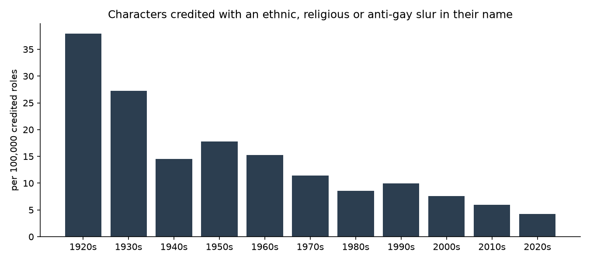

- Characters credited with a slur in their name fell from 38 per 100,000 roles in the 1920s to 4 in the 2020s.

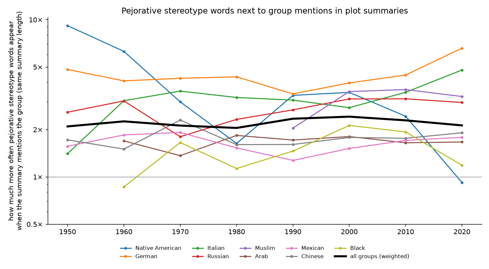

- Pejorative stereotype words have not faded from summaries that mention a group: comparing summaries of the same
  length, across groups they appear about twice as often next to a group mention in every decade since the 1950s
  (2.1 then and now).
- Native Americans are the clear decline (9 times in the 1950s, about even now, as "savage" and "warpath"
  disappeared). Germans (Nazi plots, 5 → 7) and Italians (mafia, 1.4 → 5) rose; Muslims have been tied to extremism
  words at about 3.5 times since 2000 (2 times in the 1990s).

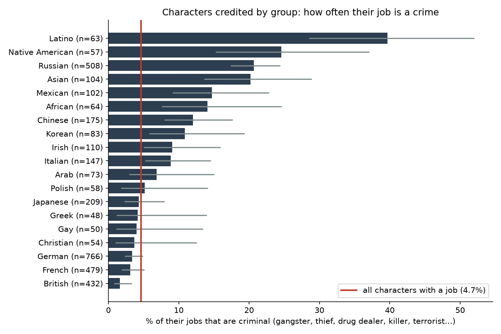

- Characters credited by a group label ("Mexican bandit", "Russian agent") are cast as criminals far more often than
  other characters with a job (4.7%): Latino 40%, Native American 25%, Russian 21%, Asian 20%. French, Italian and
  gay-labelled characters are instead given service jobs (maid, waiter, hairdresser) about three times as often.

Tables: [`results/groups/`](results/groups/), [`results/groups_offensive/`](results/groups_offensive/).

## 6. The language of plot summaries

The method from the project's original reading list (Garg et al. 2018, *PNAS*): word embeddings trained on the
summaries themselves (198 million words), with Garg et al.'s published word lists for women and men, occupations,
adjectives, surnames by group, and religion and terrorism words. Early decades are small, so one model is trained on all
text with every job and adjective word tagged by decade ("nurse_1960s"), and the gender and group words shared across
decades (temporal referencing); three training runs, averaged.

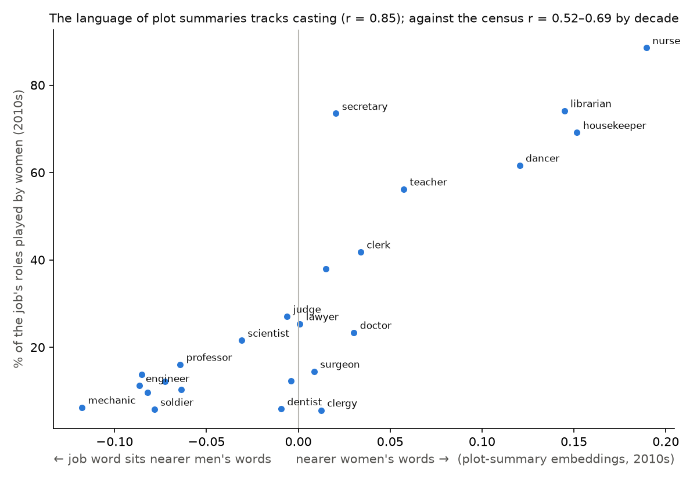

- The measure passes the paper's own test: how close a job word sits to women's words tracks women's real share of
  that job in the US census (correlation 0.52–0.69 by decade), and tracks women's share of that job on screen even more
  closely (0.80–0.91). The language of summaries, the casting and the workforce tell the same story.

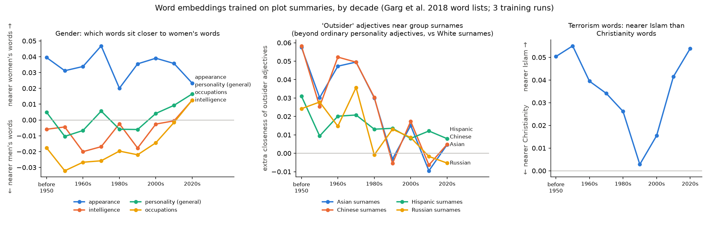

- Job words moved from clearly nearer men's words in the 1950s to slightly nearer women's words in the 2020s;
  intelligence words did the same. Appearance words sit nearest women's words in every decade.
- "Outsider" adjectives (alien, devious, inscrutable…) sat closer to Asian and Chinese surnames than ordinary
  personality adjectives did until the 1980s; since the 1990s the gap is close to zero. Intelligence words sit further
  from Hispanic than from White surnames in every decade.
- Terrorism words sat nearer Islam than Christianity words in the 1950s, were almost neutral in the 1990s, and moved
  back after 2001 to their 1950s level.

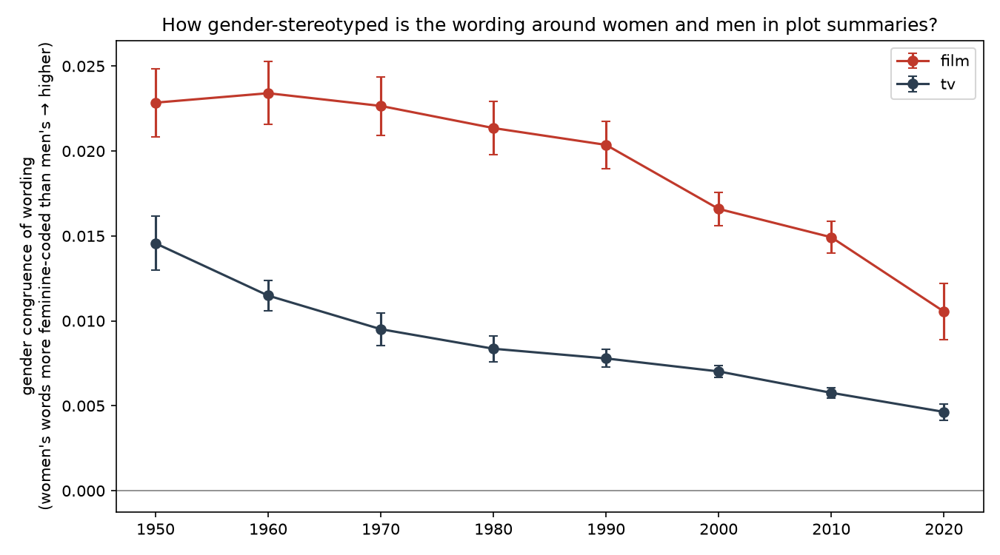

- Per summary, using general-English word vectors (GloVe): the words used for women are more feminine-coded, and those
  for men more masculine-coded, than the reverse. That gap has halved for films and fallen by two thirds for TV since
  the 1950s. Westerns have the most gender-coded wording, animation the least.

Tables: [`results/embeddings/`](results/embeddings/).

## 7. A classifier, done properly

The 2022 notebook's question, rebuilt: from a summary alone, can a model tell which titles viewers tagged with a
stereotype or prejudice keyword ("racist remark", "Italian stereotype", "homophobia"…)? 158,004 tagged titles, 7,222 of
them with such a keyword.

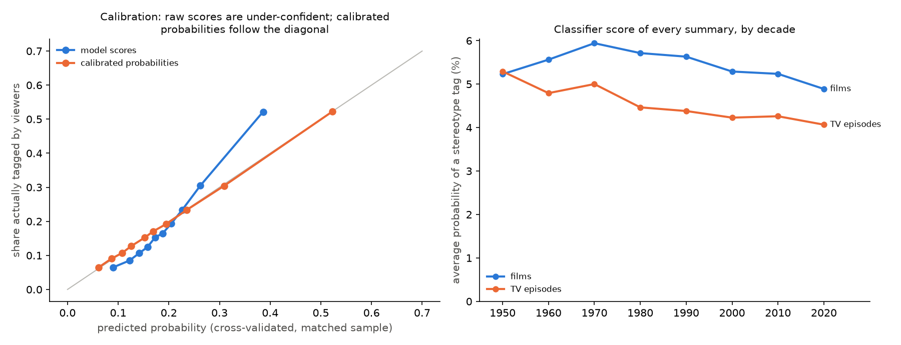

- The 2022 shortcut is gone: untagged comparison titles are matched on medium, decade, number of keywords and text
  length, so a model that sees only the length scores AUC 0.50, chance.
- With whole series kept on one side of each cross-validation split, a word-vector model reaches AUC 0.71 (films 0.73,
  TV 0.67), and a 2021 sentence-embedding model (`all-mpnet-base-v2`) 0.76 (films 0.79, TV 0.72). A small BERT
  (`MiniLM`) fine-tuned on the CPU did not converge in its one run (AUC 0.53) and is not used. Trained on careful
  labels instead of viewer tags, newer models do much better at the question that matters: see study 9.
- **What it detects is stories about prejudice, not stereotyped portrayals.** Against the careful reading in study 8,
  a third of its top 2% are stories about racism, sexism or homophobia (ten times the rate among random summaries,
  AUC 0.75), but they are *less* likely than average to portray a stereotype. Viewer tags behave the same way: they
  mark the theme. The 2022 model's 0.95 came mostly from text length, and the construct it chased was this theme.
- Calibrated on held-out folds and applied to every summary (with the word-vector model), the share likely to be a
  story about prejudice peaks for 1970s films and falls slowly after; for TV it falls from 5.3% in the 1950s to 4.1%.
- The words that weigh most are the expected ones ("racist", "racism", "discrimination", "homophobic", "sexist",
  "interracial", "prejudice"); words found in fewer than 20 different films or series are left out so the model cannot
  learn which shows were tagged.

Tables: [`results/classifier/`](results/classifier/).

## 8. Checking the measures

A labelling model read 3,000 summaries against a written codebook ([`labelling/`](labelling/)): 1,400 drawn at random
and 1,600 from what each measure flags. 300 were labelled twice, from scratch: the two passes agree on 97–99.7% of
items (Cohen's kappa 0.76–0.96). Both passes came from the same model, so that is an upper bound on how reliable the
labels are, not agreement between independent readers.

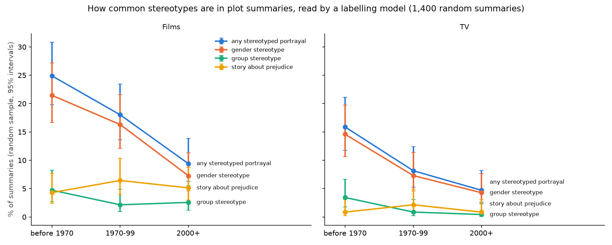

- Stereotyped portrayals fell from 25% of film summaries before 1970 to 9% since 2000, and from 16% to 5% for TV.
  Most are gender stereotypes; group stereotypes are rarer (3–5% of summaries before 1970, under 3% since).
- Stories about prejudice hold steady at 4–6% of film summaries in every era and 1–2% of TV episodes.

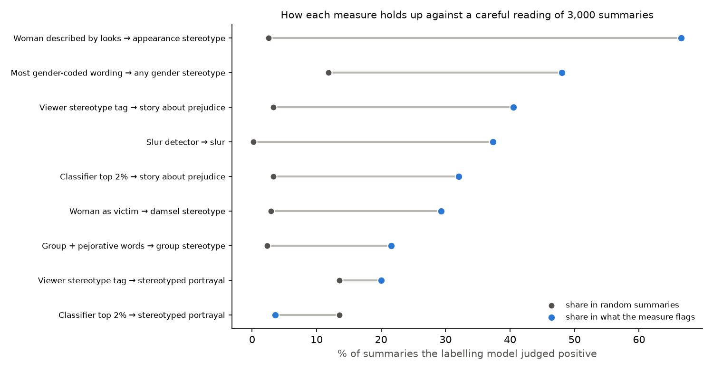

- The measures track what they claim, with false positives. "Woman described by looks" is right two times in three
  (67%, against 3% among random summaries); the most gender-coded wording carries a gender stereotype about half the
  time (48% against 12%); "woman as victim" and group-plus-pejorative-word flags are right about a quarter of the time
  (29% and 22%, against 2–3%).
- The slur detector as first built found a slur in only 37% of what it flagged: most misfires were names, places,
  foods and everyday idioms. Pruning those with these labels loses none of its true hits and lifts precision to
  77% on the same summaries, but that figure is flattering, since the same summaries chose the pruning. Choosing what
  to drop on half of them and scoring the other half gives about 51% (40–62%), the better guide for new text.
- So the trends in studies 3, 5 and 6 are trustworthy as trends; a single flagged title is not a verdict.
- Results hold when the labels the model was unsure about (confidence 1, 19% of them) are left out.

Tables: [`results/labels/`](results/labels/).

## 9. A classifier trained on careful labels

The classifier in study 7 learned what viewers tag, which turned out to be stories about prejudice. Trained instead on
the 3,000 careful labels from study 8, the question becomes the one the project set out to answer: does a summary
portray a stereotype? Each text representation feeds a logistic regression; whole series are held out in 5-fold
cross-validation, repeated three times, and the fair test is the 1,400 random summaries.

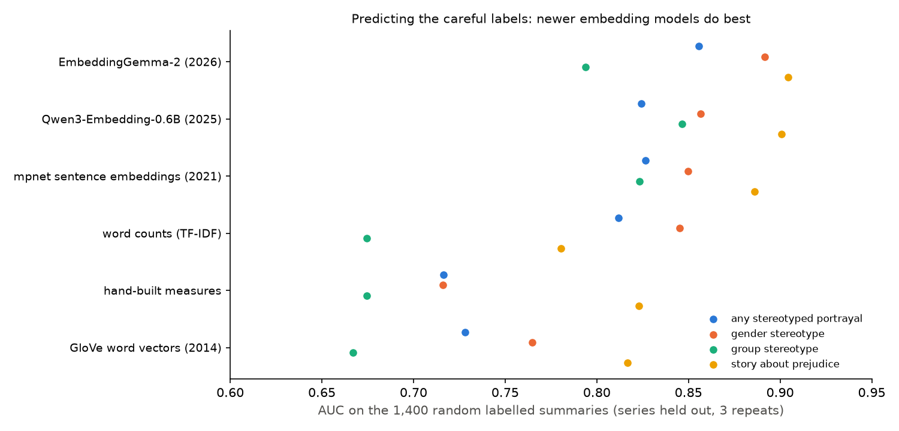

- The newest open embedding models do best. EmbeddingGemma-2 (Google, 2026) recognises stereotyped portrayals with
  AUC 0.86 and gender stereotypes with 0.89; Qwen3-Embedding-0.6B (2025) does best on group stereotypes (0.85, from
  only 33 random positives) and both reach 0.90 on stories about prejudice. A 2021 model (mpnet) is 0.02–0.04 behind
  the best model for each target (and ahead of EmbeddingGemma-2 on group stereotypes), GloVe word vectors (2014)
  0.09–0.18, and this project's hand-built measures add about 0.005 once a good embedding is in.
- In practice: of the 5% of random summaries that EmbeddingGemma-2 with the hand-built measures ranks highest, 79%
  carry a stereotyped portrayal (64% of the top 10%; 60% for the embedding alone), against 13.5% overall. Group stereotypes are rare enough (2.4%) that no model flags them precisely yet.

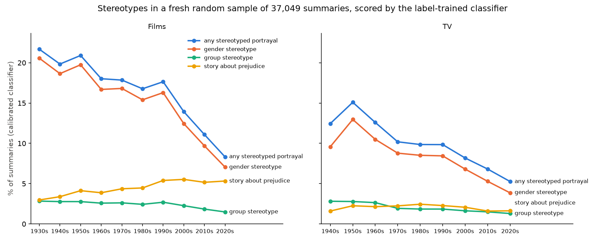

- Applied to a fresh random sample (up to 2,000 summaries per decade and medium, none of them labelled), with
  EmbeddingGemma-2 and the hand-built measures for all four targets (for group stereotypes the weaker encoder:
  random-item AUC 0.79 against Qwen3's 0.85) and probabilities calibrated on the random labelled items: stereotyped portrayals fall from 22% of 1930s film summaries
  to 8% in the 2020s, and on TV from 15% in the 1950s to 5%. Almost all of the fall is in gender stereotypes; group
  stereotypes drift down slowly (about 3% of film summaries in the 1930s–90s, 1.5% now).
- The classifier puts stories about prejudice at 3% of 1930s film summaries and 5% since the 1990s; the labels (4–6%
  in every era, study 8) neither confirm nor rule out that rise.
- All 24 era-level estimates fall inside the 95% intervals of the labelled sample; the classifier's trend is flatter
  than the labels' (about 40–65% of the labelled fall from before 1970 to 2000+), so if anything it understates the
  decline. The labels' "before 1970" also includes some films from before 1930, which the sample does not.

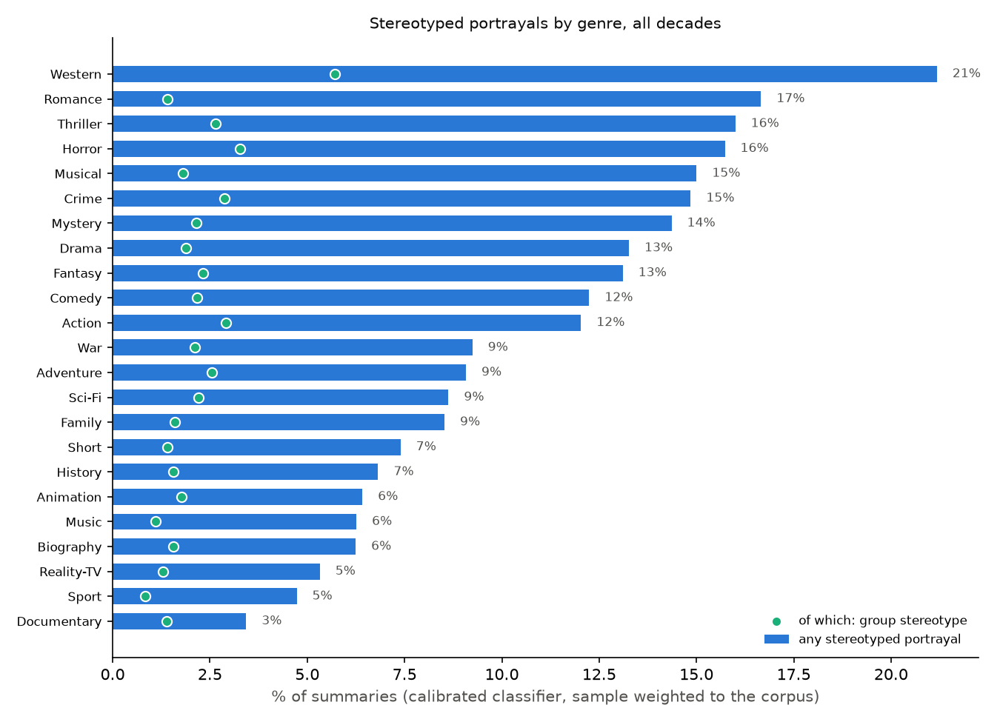

- Westerns lead (21% of summaries, with the most group stereotypes, 6%), then romance (17%, almost all gender),
  thrillers, horror, musicals and crime (15–16%); documentaries, sport and reality TV are lowest (3–5%).

Tables: [`results/label_classifier/`](results/label_classifier/).

## 10. Behind the camera, leads and ages

IMDb's crew credits (1.3 million writing and 0.9 million directing credits on fiction titles, plus producers, editors,
composers, cinematographers, casting directors and production designers), the order of each cast list, and the birth
years IMDb holds for 683,000 people.

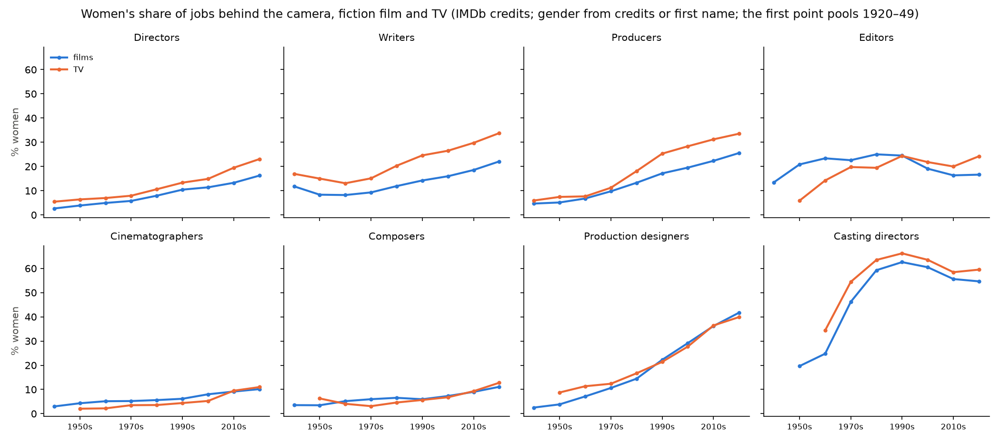

- Women went from 3% of film directors before 1950 (the first bin pools 1920–49) to 16% in the 2020s, and from 5% to
  23% in TV; from 12% of film writers (falling to 8% in the 1960s) to 22%, and from 17% to 34% of TV writers; from
  about 5% of producers to 26% (film) and 34% (TV).
- Production design rose from 3% to 42%; cinematography and music scoring are still 10–13% women. Editing and
  casting are the jobs whose shares fell: film editors from 25% in the 1980s to 17%, casting directors from 63% (film)
  and 66% (TV) in the 1990s to 55% and 59% now.
- Casting is still the one job women dominate: 55–66% since the 1980s.

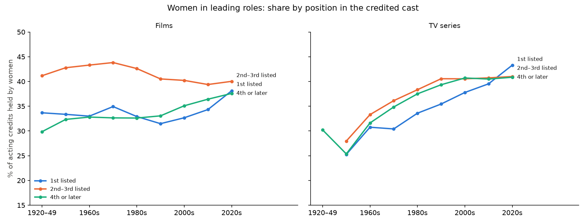

- In films, women have held about a third of first-listed roles since before 1950, and 38% in the 2020s, but 39–44% of
  second and third places: the woman's part is the second lead. In TV series women went from a quarter of first-listed
  roles in the 1950s to 43% now, ahead of film.

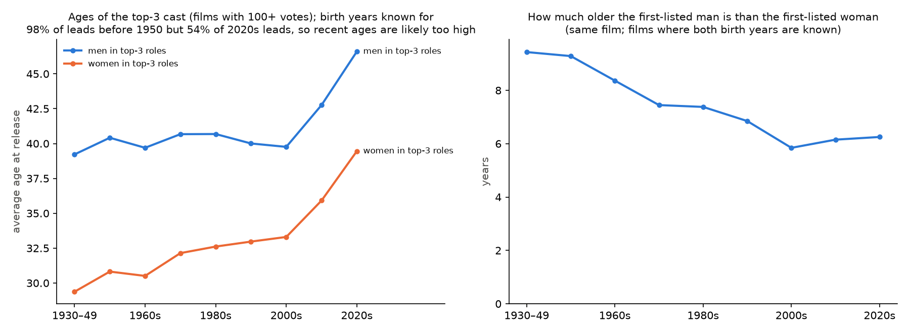

- Women in the top three film roles were about ten years younger than the men in 1930–49 (29 against 39). Within the
  same film, the first-listed man was 9.4 years older than the first-listed woman in 1930–49 and about 6 years older
  since 2000, in films where both birth years are known.
- Average ages for the 2010s and 2020s are likely too high: IMDb has birth years for 98% of leads before 1950 but
  only 54% of 2020s leads, mostly the better-known (older) ones.

Tables: [`results/behind_camera/`](results/behind_camera/).

## 11. Six more groups: immigrants, disability, mental illness, age, class and homelessness

Immigrants and refugees, disabled people, people with a mental illness, older people, poor and working-class people,
and homeless people, measured like the groups of study 5: words that name them, the stereotype words documented for
them (BBQ's age, disability and class stereotypes, curated lists for the rest) and insulting labels. A second careful
reading of 2,685 summaries ([`labelling/codebook_social.md`](labelling/codebook_social.md)) checks them, including the
same 1,400 random summaries as study 8.

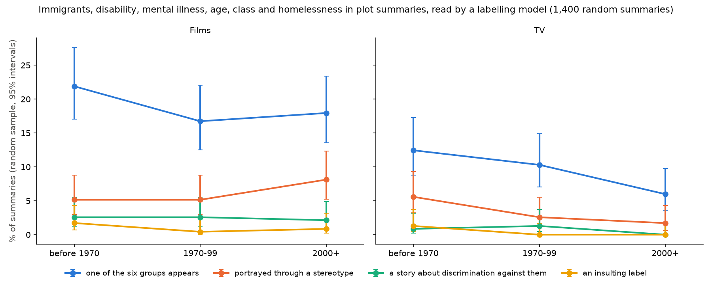

- One of the six groups appears in 17–22% of film summaries in every era and in 6–12% of TV episodes. In films they
  are portrayed through a stereotype about as often now as before 1970 (5–8% of summaries), unlike gender and the
  groups of study 5; on TV it fell from 6% to 2%.
- Where a summary names the group, it portrays people with a mental illness and disabled people through a stereotype
  almost half the time (47%), homeless people 40%, older people 36%, poor people 27% and immigrants 17%.

| Group | Stereotyped when named | Most common stereotypes |
| --- | --- | --- |
| People with a mental illness | 47% | dangerous (17 of 43), pitiable, a burden |
| Disabled people | 47% | a burden (8 of 35), an inspiration, pitiable, only a victim |
| Homeless people | 40% | only a victim (16 of 37), a moral failing, pitiable, comic |
| Older people | 36% | comic and only a victim (10 each of 34), the wise elder, declining |
| Poor and working-class people | 27% | criminal, a moral failing, the noble poor, pitiable (5 each of 25) |
| Immigrants and refugees | 17% | only a victim (7 of 15) |

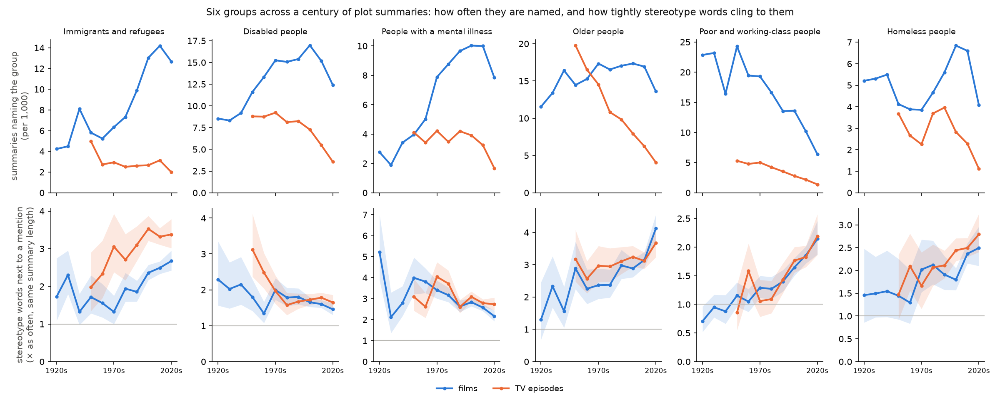

- Films name these groups explicitly more than they used to: immigrants and refugees three times as often as in the
  1920s (4 → 13 per 1,000 film summaries), people with a mental illness about three times (3 → 8–10) and disabled
  people one and a half to two times (8.5 → 12–17); older people steadily (12–17), homeless people about as often as
  in the 1920s (4–7). Poor and working-class people are the exception, named a quarter as often (23 → 6). TV episodes
  name all six less over time (older people from 20 to 4 per 1,000 since the 1950s). These are rates per summary, and
  2020s summaries are 30–40% shorter than those of the 2000s, so part of any fall to the 2020s is shorter summaries.
- Where they are named, stereotype words cling more tightly to immigrants (1.7 → 2.7 times as often as elsewhere in
  film summaries), homeless people (1.5 → 2.5), poor people (0.7 → 2.1) and older people (about 2.3–2.9 in the 1950s–80s →
  4.1), and less tightly to disabled people (2.3 → 1.5) and people with a mental illness (4.0 in the 1950s → 2.2),
  comparing summaries of the same length. TV shows the same directions, though for older people and mental illness
  only as point estimates, and the 1920s starting points for immigrants and homeless people rest on few summaries.
- Insulting labels faded for homeless and poor people (in films from 513 and 187–289 per 100,000 summaries in the
  1920s–30s to 14 and 27) and for disabled people (about 100–150 → 11). Labels for mental illness are the exception:
  in films they rose from about 130 per 100,000 summaries in the 1920s to 600 in the 1990s, and are still 200. Like
  the naming rates, these are per summary, so the 2020s values are partly lower because summaries are shorter.
- Checking the measures: the mention lists are right 89–95% of the time (disability 74%) but catch only about a
  third of the people the labelling model finds, so the decade chart follows explicit naming while the labels above
  give prevalence. A group named in the same summary as a pejorative stereotype word is stereotyped 36–76% of the
  time, against 15–43% of flagged summaries for a plain mention; insulting labels are right about 80% of the time
  after pruning (out-of-sample estimate; in-sample by group, 60% for disability labels and 76–96% for the others); titles viewers tagged with a theme name its group 38–168 times as often as other titles. The two
  labelling passes agree closely (kappa 0.81–1.00), but the second was a reread in the same session.

**Reading whole summaries.** A classifier trained on the 2,685 labels (EmbeddingGemma-2 and the measures above, as
in study 9) also counts people who are described rather than named. On the 1,400 random labelled summaries it scores
AUC 0.89 for whether one of the six groups appears, 0.87 for a stereotyped portrayal and 0.83 for a story about
discrimination (0.85–0.96 for each group's presence); on study 9's fresh sample, 17 of its 18 era estimates fall
inside the labels' 95% intervals (a consistency check, since the probabilities are calibrated on the same labels).

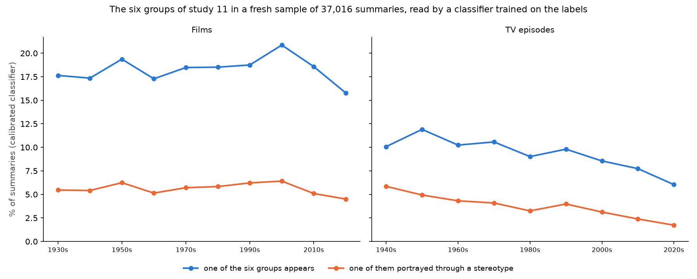

- Films portray these groups through a stereotype in a steady 5–6% of summaries from the 1930s to the 2010s, and
  4.5% in the 2020s; on TV the share fell from 5% in the 1950s to under 2%. For films since 2000 the classifier's 5.2% falls
  just below the labels' interval (8%, 5.3–12.3%), the one era estimate outside it.

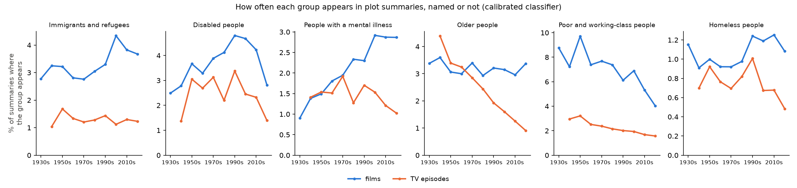

- Read whole, the trends are gentler than explicit naming suggests: immigrants and refugees appear in 3% of film
  summaries in the 1930s and about 4% since 2000, people with a mental illness three times as often as in the 1930s
  (0.9% → 2.9%), poor people half as often (8.8% → 4.0%) and older people steadily (about 3%). TV episodes feature
  older people a fifth as often as in the 1940s (4.4% → 0.9%).
- Horror (8.5% of summaries), Westerns (7.4%), thrillers and mysteries stereotype these groups most; sport, reality
  TV, music, documentaries and history least (under 3%) ([chart](results/label_classifier_social/sample_by_genre.png)).

Tables: [`results/groups_social/`](results/groups_social/), [`results/groups_offensive_social/`](results/groups_offensive_social/),
[`results/labels_social/`](results/labels_social/), [`results/label_classifier_social/`](results/label_classifier_social/).

## 12. Money, critics and awards

Do box office, critics and the Academy treat stereotyped films and women on screen the way IMDb voters do (study 4)?
Budgets and worldwide box office from TMDb (11,929 films with both, in 2025 dollars); critic and audience scores
from the films' own Rotten Tomatoes and Metacritic pages, and from Wikidata for films beyond them (the Tomatometer
for 23,083 films, the Metascore for 11,542, audience scores for 16,242 and 10,541); Academy Award nominations from
Wikidata, and Golden Globe, BAFTA and Primetime Emmy nominations from Wikipedia's award pages (11,708 nominations);
viewer counts for 50,127 TV episodes from Wikipedia's episode tables (mostly US Nielsen figures; about 13% from British
BARB and other national ratings); and, for TV, the first season of
6,639 finished scripted series scored by both classifiers. Compared as in study 4.

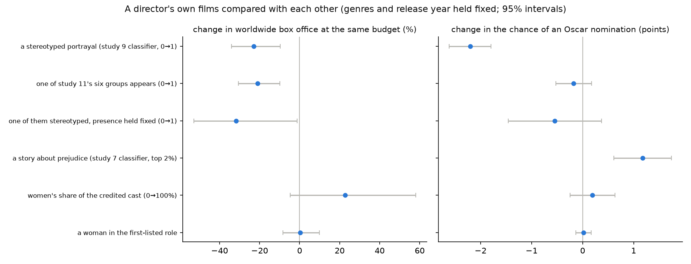

- Stereotyped portrayals go with less money and fewer awards. A film whose summary the study 9 classifier is sure
  portrays a stereotype takes 23% less at the box office than its director's other films, with budget, genres and
  release year held fixed, and is 2.2 points less likely to be nominated for an Oscar (about 1 rated film in 85 is
  nominated).
- Films featuring study 11's six groups take 21% less at the box office, although IMDb voters rate them higher, and
  stereotyping them goes with a further third less (32%), a loose estimate.
- Stories about prejudice fare better with the Academy: 1.2 points more likely to be nominated than the director's
  other films, and 4.5 points higher on the Tomatometer.
- The Golden Globes and the BAFTAs agree (they nominate 0.8% and 0.6% of rated films): a stereotyped portrayal goes with a
  nomination 1.1 and 1.3 points less likely, a story about prejudice 0.8 and 0.7 points more. The Globes, with
  separate actress categories for drama and comedy, also nominate films with more women in the cast more often among
  a director's films (0.7 points for an all-female against an all-male cast; not across similar films).
- Films with more women on screen return more on their budget (box office divided by budget: 30% more for an
  all-female against an all-male cast among a director's films, a loose estimate, and 38% across similar films; with
  budget as a control instead, the director comparison gives 23% and is not clear). Critics mark them down little or
  not at all (only the Rotten Tomatoes critics' average, by 0.06 of 10 for a woman in the first-listed role), while
  audiences on all three sites do: a woman in the first-listed role goes with 1.7 points less Rotten Tomatoes audience
  score and 0.15 less Metacritic user score among a director's films, as with 0.06 less on IMDb.
- No clear sign of "Oscar bait": films featuring disabled people or people with a mental illness are not clearly more
  likely than comparable films to earn an acting nomination, though the intervals cannot rule out up to about 1
  point on a 0.5% base. This is measured for the film, not the role.

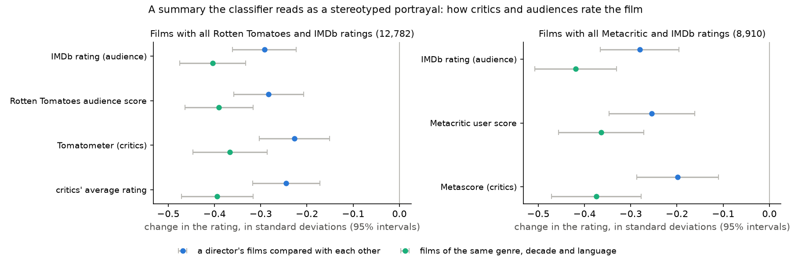

- Critics and audiences mark stereotyped portrayals down alike: on the same films, among a director's films, a
  stereotyped portrayal goes with a Tomatometer 0.23 standard deviations lower and a Metascore 0.20 lower, against
  0.25–0.29 for the three audiences (IMDb, Rotten Tomatoes and Metacritic users); across similar films, all of them
  are 0.36–0.42 lower.
- TV audiences: within a series, none of study 4's word-list and casting measures goes with an episode's viewer count
  by more than a few percent, and none clearly; the classifiers were not run on these episodes.
- Series that open with stereotyped portrayals are renewed a little less often. From a first season among the tenth
  least stereotyped to one among the tenth most (a mean probability of 3% against 24%), a series is about 4 points
  less likely to get a second season (57% of these 6,639 series do), compared within network and start year or across
  similar series; a loose estimate, whose intervals end close to zero. Across similar series such series also run
  about 6% fewer seasons over the same range; within network and start year that interval includes zero. Series that
  feature study 11's six groups are renewed as often or more.
- Emmy and Golden Globe nominations (3.0% and 3.5% of these series) show no clear penalty for stereotyped portrayals.
  Series that feature the six groups are nominated more often: from the tenth of series least likely to feature them
  to the tenth most likely (2% against 25%), about 3 points more often for a Golden Globe and 2–3 points more often
  for an Emmy (one of the two Emmy comparisons only borderline). Stereotyping those groups goes with no more
  nominations (among a network's series of the same year, fewer Golden Globes).
- The critic and audience scores were read from the films' own pages in October 2026 for the 17,569 (Rotten
  Tomatoes) and 11,482 (Metacritic) films with at least 5,000 IMDb votes, and taken from Wikidata's copies for the
  rest (retrieved 2021–26), so the comparison with audiences concerns films with a real audience. TMDb's budgets and
  box office are entered by contributors and cover mostly US and studio films.

Tables: [`results/reception/`](results/reception/).

## 13. Who makes stereotyped films, and where

With the 188,049 rated films that have a summary scored (study 4) and the expected gender of their directors and
writers (study 10), the question can be turned around: who makes stereotyped films? Series are scored on their first season (study 12) and TMDb records
the gender of their creators. Compared like for like, as in study 4.

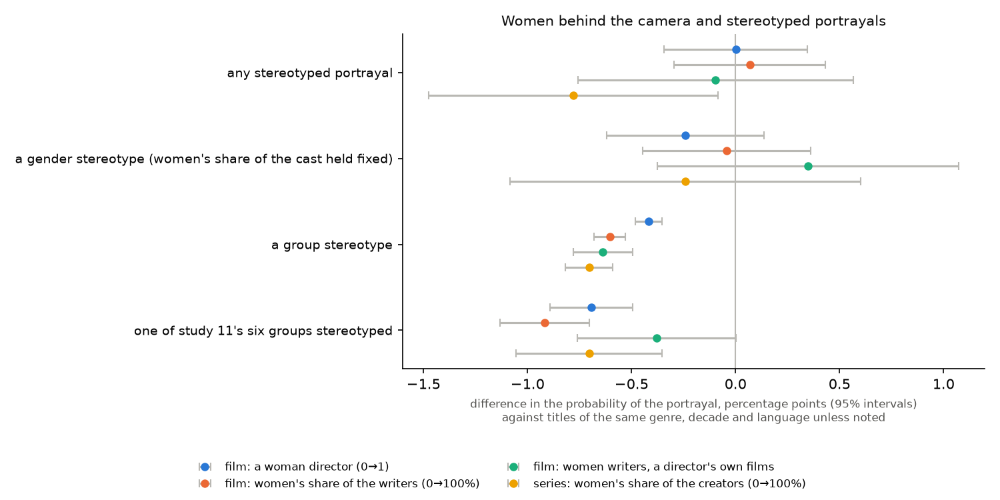

- Films directed or written by women contain no fewer stereotyped portrayals overall, but fewer group stereotypes:
  0.4 points fewer with a woman director and 0.6 fewer with an all-women writing team, against a base rate of about
  3%, and as many fewer among a director's own films; and fewer stereotyped portrayals of study 11's six groups (0.7
  and 0.9 points). Within franchises the estimates are noisier (women writers 1.4 points fewer group stereotypes,
  women directors 0.2 more, not significant).
- At first sight they carry more gender stereotypes (1.6 points more with women writers), but only because they
  centre more on women: with the share of women in the cast held fixed, the difference disappears.
- Series created by women show the same pattern in their first season: with an all-women team of creators, 0.7
  points fewer group stereotypes (against 2.1%, a third fewer), 0.7 fewer stereotyped portrayals of the six groups
  (against 4.1%) and no more gender stereotypes (+0.4 points, not significant; −0.2 with the cast held fixed). Unlike
  films, they also carry fewer stereotyped portrayals overall (0.8 points fewer, against 11.6%), a loose estimate. TMDb
  records at least one creator's gender for 4,368 of the 6,639 series (all of them for 3,920), and 2,803 can be
  compared like for like.

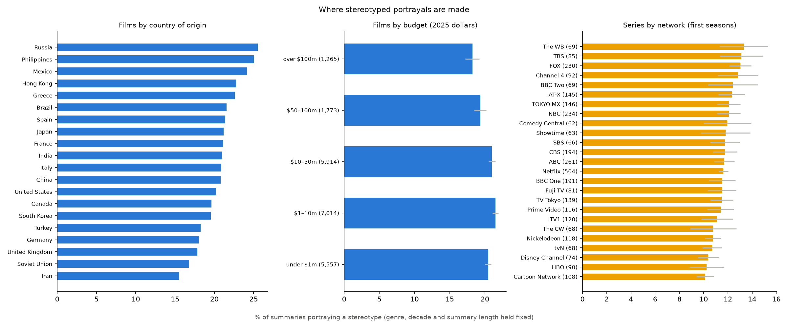

- Bigger films stereotype a little less: 18% of the summaries of films that cost over $100 million, against 21–22%
  for films of $1–50 million, with genre, decade and summary length (and source) held fixed. Bigger films get longer
  summaries; without the length control the gap is about 1 point.
- By country of origin (TMDb) the share runs from 16–18% (Iran, the Soviet Union, the UK, Germany, Turkey) to 24–26%
  (Mexico, the Philippines, Russia), with the US at 20%. These are English-language summaries, so the comparison partly reflects
  how each country's films are described in English.
- Among films since 1970, by first-listed production company, Hollywood's majors range from 18.6% (Warner Bros.) to
  23% (MGM); the extremes are East Germany's DEFA (15.5%) and
  Japan's Nikkatsu (33%; nearly three in four of its films since 1970 date from 1971–88, the years of its erotic "Roman Porno"
  line). Streaming originals since 2015 stereotype about as often as other films of those years (13% against 14%, a
  gap within the noise of only 228 films).
- TV networks differ less than film studios: with genre, decade and summary length held fixed, 10% of first-season
  summaries portray a stereotype on Cartoon Network, HBO and Disney Channel, against 13% on FOX, TBS, The WB and
  Channel 4; Netflix sits at the average (11.6%, 504 series; 10% without the length control). Study 11's six groups
  are stereotyped most on Comedy Central and FOX (5.7% and 5.1%, against 4.3% across these networks).

Tables: [`results/makers/`](results/makers/).

## How it was measured

- **Gender** comes from IMDb's actor/actress credit category, TMDb's gender field and, in summaries, from pronouns,
  gendered nouns and the title's own cast list (a character name that belongs only to roles played by actresses counts
  as a woman). Non-binary identities are rarely recorded in either source.
- **Gender behind the camera** (study 10, and study 2 for films): IMDb records none. People with acting credits get
  theirs from the credit; everyone else gets a probability from their first name, learned from 3.8 million performers.
  Averaging that probability estimates a group's share of women without bias (held-out performers: 36.55% predicted
  against 36.56% actual), where hard yes/no labels would undercount women; against TMDb's own gender field for 12,188
  writers and directors it gives 27.6% women against TMDb's 29.5%, so it is slightly conservative.
- **Jobs** are recognised in character names with a hand-checked word list: the last job word wins ("police
  detective" → detective), words that are also surnames count only when used as a job ("the baker", not "John
  Baker"), and gendered job words (waitress, policeman) are kept apart. English-language productions only, since an
  English list misses feminine job forms in other languages.
- **Casting skew** compares women's share in a job with women's share of all named fictional roles in the same period,
  so the general rise in women's roles is not mistaken for a change in a job's image.
- **Within-series comparisons** (studies 2 and 4) use series and year fixed effects with standard errors clustered by
  series. **Film comparisons** use the director, the franchise (TMDb collection) or the genre combination and decade
  as fixed effects; in study 4 the director and franchise comparisons add release-year effects and genre dummies, the
  genre comparison also holds the original language fixed, and standard errors are clustered by director or
  franchise. Measures from summaries are compared at the same summary length and source.
- **Summaries** are joined to IMDb episodes through TMDb only for series whose season and episode numbering lines up
  with IMDb's (episode titles or air years agree); 15,107 series that do not are kept apart.
- **Group mentions** are matched with their capitalisation ("Polish" counts, "polish the silver" does not). Stereotype
  words come from SeeGULL, StereoSet and short curated lists; the pejorative index keeps SeeGULL words its raters
  scored offensive, words in HurtLex and a short pejorative list. Phrases that name a thing rather than people
  ("French toast", "German shepherd", "White House") are not mentions. Slurs that are also common names or everyday
  words are dropped; the list was then pruned against the labelled summaries of study 8, removing 41 terms the labels
  never confirmed that, read in context, were names, places, foods, objects or plain descriptions, and cutting a few
  everyday idioms that contain a slur before matching.
- **Stereotype pairing** (studies 5 and 11) compares how often a group's stereotype words appear in summaries that
  mention the group with summaries that do not, within bands of summary length (a Mantel–Haenszel ratio over
  length deciles): longer summaries are likelier both to mention a group and to contain any given word, which
  inflates the plain ratio.
- **The six groups of study 11** are named by identity terms (and a few condition and institution words, such as
  "psychiatric hospital") cross-checked against HolisticBias's descriptors
  (numeric ages count from 65), with idioms removed ("blind date", "fell on deaf ears", "disabled the alarm"). Their
  insulting labels, like the slur lists, are kept out of the repository; the labels pruned 12 that were mostly
  surnames, other uses or outdated descriptions, and the pruned list is right about 80% of the time (out-of-sample
  estimate).
- **Critics, money and awards** (study 12): Wikidata's review scores and Academy Award records, TMDb's budgets and
  box office in 2025 dollars (US consumer price index), and the films' own Rotten Tomatoes and Metacritic pages,
  fetched slowly and openly for the films with at least 5,000 IMDb votes: one request every 2–4 seconds, a User-Agent
  that names this project, film pages only (as both sites' robots.txt allow), and a stop if a site refuses. TV viewer counts come from the "Viewers" column of
  the same Wikipedia episode tables as the summaries.
- **Award nominations** (study 12): the Academy Awards from Wikidata; the Golden Globes, the BAFTA film awards and the
  Primetime Emmys from Wikipedia's category pages (each year's nominees, the winner highlighted), traced to IMDb
  through Wikidata (97%).
- **Series' first seasons** (studies 12 and 13): up to six first-season episodes of each finished scripted series
  (first aired 1990–2022, at least 500 IMDb votes, at least three first-season summaries of 15–350 words: 6,639 of
  8,521 series), scored by both label-trained classifiers and averaged; compared at
  the same mean summary length, and for gender stereotypes also with the women's share of those episodes' credited
  cast held fixed. Clustered by network.
- **Wikipedia episode summaries** come from season and episode-list pages ({{Episode list}}), traced to the series'
  IMDb id through Wikidata and kept only for series whose episode titles agree with IMDb's.

## Caveats

- Credits and summaries are written by IMDb and TMDb contributors, not by the productions.
- The full stereotype word lists mix pejorative words with neutral topic words ("mexico", "reservation"), which is why
  the pejorative index exists; both measure association, not a judgement on any single title.
- Ratings come from IMDb's self-selected voters.
- The labels in study 8 come from one language model following a written codebook; a second pass by the same model
  agrees closely, which shows consistency but not that independent human readers would agree.
- IMDb lists casts in credits order, usually billing order but sometimes order of appearance, so "first-listed" is an
  approximation of the lead; the top three is the steadier measure.
- Study 11's word lists catch about a third of the members of the six groups that a careful reader finds: people are
  often described rather than named ("a widow in her seventies", "a family that cannot pay the rent"). Its decade
  trends therefore follow explicit naming; the labels give the prevalence.
- The second labelling pass of study 11 was a reread in the same session, so its agreement (kappa 0.81–1.00) is an
  even looser upper bound than study 8's.
- Garg et al.'s Black surname list overlaps heavily with common White surnames, so the embeddings give no usable
  Black–White contrast; surnames also stand in for groups only roughly.
- Every comparison is observational: fixed effects hold fixed what titles share within a series, director,
  franchise, network or year, not every other difference between them, so the results are associations, not effects.
- The "woman as victim" flag now also counts passive "raped" (spaCy lemmatises it as "rap"). The classifiers'
  hand-built features were computed before that fix; those features add at most 0.006 AUC, so the scores were not
  recomputed.

## Reproduce

Set `STEREOTYPES_DATA` to a local folder holding the sources below and `PYTHON` to an environment with pandas, pyarrow,
duckdb, statsmodels, scikit-learn, gensim, spacy (`en_core_web_sm`), torch, torchvision, sentence-transformers,
transformers, mwparserfromhell, matplotlib, lxml, jsonschema and wordfreq, then run `bash src/run_all.sh` (or
`bash src/run_all.sh <step>` to start from a step). `src/transformer.py` runs separately, as does the chain of studies 8 and 9:
`src/label_sample.py`, the labelling run (`labelling/`), `src/validate_labels.py labels.jsonl labels_second.jsonl`,
`src/label_classifier.py` (about four hours on a CPU), `src/score_sample.py` (about two hours) and
`src/calibration_check.py`.
`src/imdb_people.py`, `src/behind_camera.py`, `src/film_writers.py` and `src/ratings_films.py` add the crew, leads and
ages (studies 2 and 10) and the films half of study 4; `src/label_sample_social.py`,
`src/validate_labels_social.py` and `src/social_classifier.py` (about 50 minutes on a CPU) draw, score and model
study 11's labelling sample; `src/score_films.py` (about ten hours on a CPU, resumable) scores every rated film with
both label-trained classifiers for study 4. Study 12 runs `src/wikidata_reception.py`, `src/reception_fetch.py rt|mc`
(about a day at its pace, resumable), `src/wiki_fetch.py --viewers-only`, `src/wiki_awards.py`, `src/reception.py`,
`src/score_series.py` (about three hours) and `src/series_reception.py`; study 13 runs `src/makers.py`. Run `src/figures.py` again at the end to redraw the charts from the separately run
scripts. No raw data is stored in this repository.

## Data and terms

- IMDb non-commercial datasets (2026-10-07): personal, non-commercial use; not republished here.
  *Information courtesy of IMDb ([https://www.imdb.com](https://www.imdb.com)). Used with permission.*
- TMDb API (fetched 2026-10-07 to 09). Cached copies are refreshed or deleted within six months; none are shared.

  

  This product uses the TMDB API but is not endorsed or certified by TMDB.
- Plot text and keywords collected for the 2022 project, and IMDb's 2017 plot list: private copies, not republished.
- Wikipedia episode summaries (CC BY-SA 4.0) and Wikidata links (CC0), fetched through the official APIs.
- Garg et al. (2018) word lists and their census occupation shares by decade (from IPUMS), from the authors'
  repository; GloVe word vectors (PDDL); `all-mpnet-base-v2` (Apache-2.0), `MiniLM-L12-H384` (MIT),
  `Qwen3-Embedding-0.6B` (Apache-2.0) and `EmbeddingGemma-2` (Apache-2.0), all run locally.
- SeeGULL (Google, CC BY 4.0), StereoSet (CC BY-SA 4.0), HurtLex (CC BY-NC-SA 4.0), Wikipedia lists of ethnic and
  religious slurs (CC BY-SA 4.0). The lexicon built from them is not included; it keeps their licences.
- BBQ (Parrish et al. 2022, CC BY 4.0) for the age, disability and class stereotypes of study 11, and HolisticBias
  (Smith et al. 2022, dataset CC BY-SA 4.0) for its identity terms.
- Wikidata review scores and award records (CC0); Wikipedia's Golden Globe, BAFTA and Emmy pages (CC BY-SA 4.0); Rotten Tomatoes and Metacritic scores read from their public film
  pages for non-commercial research (the pages are not republished); the US consumer price index (BLS, public
  domain, via FRED).

## References

The project's original reading list, gathered with Stefano Li Pira in 2022 (the
[`references`](https://github.com/stefanolipira/stereotypes_tvseries/tree/main/references) folder of the 2022
repository):

- Charlesworth, T. E. S., Yang, V., Mann, T. C., Kurdi, B., & Banaji, M. R. (2021). Gender stereotypes in natural
  language: Word embeddings show robust consistency across child and adult language corpora of more than 65 million
  words. *Psychological Science*, 32(2), 218–240. <https://doi.org/10.1177/0956797620963619>
- Garg, N., Schiebinger, L., Jurafsky, D., & Zou, J. (2018). Word embeddings quantify 100 years of gender and ethnic
  stereotypes. *Proceedings of the National Academy of Sciences*, 115(16), E3635–E3644.
  <https://doi.org/10.1073/pnas.1720347115> (the method of study 6)
- Kagan, D., Chesney, T., & Fire, M. (2020). Using data science to understand the film industry's gender gap.
  *Palgrave Communications*, 6, 92. <https://doi.org/10.1057/s41599-020-0436-1>
- Vicinanza, P., Goldberg, A., & Srivastava, S. B. (2023). A deep-learning model of prescient ideas demonstrates that
  they emerge from the periphery. *PNAS Nexus*, 2(1), pgac275. <https://doi.org/10.1093/pnasnexus/pgac275> (read in
  2022 as the working paper "Quantifying vision through language demonstrates that visionary ideas come from the
  periphery")

Word lists and benchmarks:

- Bassignana, E., Basile, V., & Patti, V. (2018). Hurtlex: A multilingual lexicon of words to hurt. *Proceedings of
  the Fifth Italian Conference on Computational Linguistics (CLiC-it 2018)*, CEUR Workshop Proceedings 2253.
  <https://ceur-ws.org/Vol-2253/paper49.pdf>
- Jha, A., Davani, A., Reddy, C. K., Dave, S., Prabhakaran, V., & Dev, S. (2023). SeeGULL: A stereotype benchmark with
  broad geo-cultural coverage leveraging generative models. *Proceedings of ACL 2023*.
  <https://doi.org/10.18653/v1/2023.acl-long.548>
- Nadeem, M., Bethke, A., & Reddy, S. (2021). StereoSet: Measuring stereotypical bias in pretrained language models.
  *Proceedings of ACL-IJCNLP 2021*. <https://doi.org/10.18653/v1/2021.acl-long.416>
- Parrish, A., Chen, A., Nangia, N., Padmakumar, V., Phang, J., Thompson, J., Htut, P. M., & Bowman, S. R. (2022). BBQ:
  A hand-built bias benchmark for question answering. *Findings of ACL 2022*.
  <https://doi.org/10.18653/v1/2022.findings-acl.165>
- Smith, E. M., Hall, M., Kambadur, M., Presani, E., & Williams, A. (2022). "I'm sorry to hear that": Finding new
  biases in language models with a holistic descriptor dataset. *Proceedings of EMNLP 2022*.
  <https://doi.org/10.18653/v1/2022.emnlp-main.625>
- Speer, R. (2022). rspeer/wordfreq: v3.0 (v3.0.2). Zenodo. <https://doi.org/10.5281/zenodo.7199437>

Word embeddings and language models:

- Devlin, J., Chang, M.-W., Lee, K., & Toutanova, K. (2019). BERT: Pre-training of deep bidirectional transformers for
  language understanding. *Proceedings of NAACL-HLT 2019*. <https://doi.org/10.18653/v1/N19-1423>
- Dubossarsky, H., Hengchen, S., Tahmasebi, N., & Schlechtweg, D. (2019). Time-Out: Temporal referencing for robust
  modeling of lexical semantic change. *Proceedings of ACL 2019*. <https://doi.org/10.18653/v1/P19-1044>
- Google DeepMind. EmbeddingGemma 2 (model card). <https://huggingface.co/google/embeddinggemma-2>
- Mikolov, T., Sutskever, I., Chen, K., Corrado, G., & Dean, J. (2013). Distributed representations of words and
  phrases and their compositionality. *Advances in Neural Information Processing Systems 26*. arXiv:1310.4546
- Pennington, J., Socher, R., & Manning, C. D. (2014). GloVe: Global vectors for word representation. *Proceedings of
  EMNLP 2014*. <https://doi.org/10.3115/v1/D14-1162>
- Reimers, N., & Gurevych, I. (2019). Sentence-BERT: Sentence embeddings using Siamese BERT-networks. *Proceedings of
  EMNLP-IJCNLP 2019*. <https://doi.org/10.18653/v1/D19-1410>
- Song, K., Tan, X., Qin, T., Lu, J., & Liu, T.-Y. (2020). MPNet: Masked and permuted pre-training for language
  understanding. *Advances in Neural Information Processing Systems 33*. arXiv:2004.09297
- Wang, W., Wei, F., Dong, L., Bao, H., Yang, N., & Zhou, M. (2020). MiniLM: Deep self-attention distillation for
  task-agnostic compression of pre-trained transformers. *Advances in Neural Information Processing Systems 33*.
  arXiv:2002.10957
- Zhang, Y., Li, M., Long, D., Zhang, X., Lin, H., Yang, B., Xie, P., Yang, A., Liu, D., Lin, J., Huang, F., & Zhou, J.
  (2025). Qwen3 Embedding: Advancing text embedding and reranking through foundation models. arXiv:2506.05176

Statistical methods:

- Cameron, A. C., & Miller, D. L. (2015). A practitioner's guide to cluster-robust inference. *Journal of Human
  Resources*, 50(2), 317–372. <https://doi.org/10.3368/jhr.50.2.317>
- Cohen, J. (1960). A coefficient of agreement for nominal scales. *Educational and Psychological Measurement*, 20(1),
  37–46. <https://doi.org/10.1177/001316446002000104>
- Frisch, R., & Waugh, F. V. (1933). Partial time regressions as compared with individual trends. *Econometrica*, 1(4),
  387–401. <https://doi.org/10.2307/1907330>
- Greenland, S., & Robins, J. M. (1985). Estimation of a common effect parameter from sparse follow-up data.
  *Biometrics*, 41(1), 55–68. <https://doi.org/10.2307/2530643>
- Guimarães, P., & Portugal, P. (2010). A simple feasible procedure to fit models with high-dimensional fixed effects.
  *The Stata Journal*, 10(4), 628–649. <https://doi.org/10.1177/1536867X1001000406>
- Lovell, M. C. (1963). Seasonal adjustment of economic time series and multiple regression analysis. *Journal of the
  American Statistical Association*, 58(304), 993–1010. <https://doi.org/10.1080/01621459.1963.10480682>
- Mantel, N., & Haenszel, W. (1959). Statistical aspects of the analysis of data from retrospective studies of disease.
  *Journal of the National Cancer Institute*, 22(4), 719–748. <https://doi.org/10.1093/jnci/22.4.719>
- Monroe, B. L., Colaresi, M. P., & Quinn, K. M. (2008). Fightin' words: Lexical feature selection and evaluation for
  identifying the content of political conflict. *Political Analysis*, 16(4), 372–403.
  <https://doi.org/10.1093/pan/mpn018>
- Platt, J. C. (1999). Probabilistic outputs for support vector machines and comparisons to regularized likelihood
  methods. In A. J. Smola, P. Bartlett, B. Schölkopf, & D. Schuurmans (Eds.), *Advances in Large Margin Classifiers*
  (pp. 61–74). MIT Press.
- Wilson, E. B. (1927). Probable inference, the law of succession, and statistical inference. *Journal of the American
  Statistical Association*, 22(158), 209–212. <https://doi.org/10.1080/01621459.1927.10502953>
- Zadrozny, B., & Elkan, C. (2002). Transforming classifier scores into accurate multiclass probability estimates.
  *Proceedings of KDD 2002*, 694–699. <https://doi.org/10.1145/775047.775151>

Data and software (the data sources and their terms are listed under [Data and terms](#data-and-terms)):

- Vrandečić, D., & Krötzsch, M. (2014). Wikidata: A free collaborative knowledgebase. *Communications of the ACM*,
  57(10), 78–85. <https://doi.org/10.1145/2629489>
- U.S. Bureau of Labor Statistics. Consumer Price Index for All Urban Consumers: All Items in U.S. City Average
  [CPIAUCNS], retrieved from FRED, Federal Reserve Bank of St. Louis, 2026-10-19.
  <https://fred.stlouisfed.org/series/CPIAUCNS>
- Honnibal, M., Montani, I., Van Landeghem, S., & Boyd, A. (2020). spaCy: Industrial-strength natural language
  processing in Python. Zenodo. <https://doi.org/10.5281/zenodo.1212303>
- Pedregosa, F., Varoquaux, G., Gramfort, A., Michel, V., Thirion, B., Grisel, O., Blondel, M., Prettenhofer, P.,
  Weiss, R., Dubourg, V., Vanderplas, J., Passos, A., Cournapeau, D., Brucher, M., Perrot, M., & Duchesnay, É. (2011).
  Scikit-learn: Machine learning in Python. *Journal of Machine Learning Research*, 12, 2825–2830.
- Řehůřek, R., & Sojka, P. (2010). Software framework for topic modelling with large corpora. *Proceedings of the LREC
  2010 Workshop on New Challenges for NLP Frameworks*, 45–50.
- Seabold, S., & Perktold, J. (2010). statsmodels: Econometric and statistical modeling with Python. *Proceedings of
  the 9th Python in Science Conference*.

## Licence

Code: MIT (see `LICENSE`; the 2022 notebook is © Alexandru Pascu and Stefano Li Pira). Results tables and figures:
CC BY 4.0, with the source attributions above.
